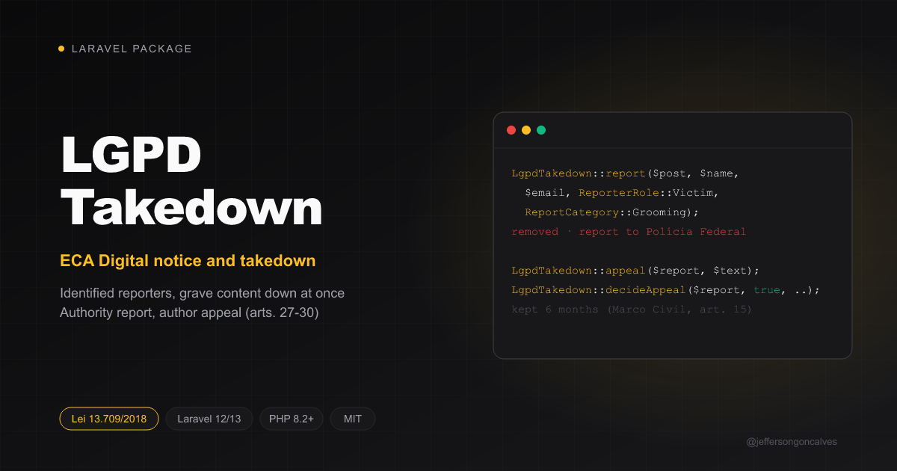

# Laravel LGPD Takedown



[](https://packagist.org/packages/jeffersongoncalves/laravel-lgpd-takedown)
[](https://github.com/jeffersongoncalves/laravel-lgpd-takedown/actions/workflows/tests.yml)
[](https://packagist.org/packages/jeffersongoncalves/laravel-lgpd-takedown)

Notice and takedown for Brazil's Digital Statute of Children and Adolescents, known as **ECA Digital** (Lei 15.211/2025, arts. 27 to 30, 32 and 33, regulated by Decreto 12.880/2026). It covers content that violates the rights of children and adolescents. It is part of the [laravel-lgpd](https://github.com/jeffersongoncalves/laravel-lgpd) suite.

- **Public notice channel (arts. 28 and 29, §3):** an optional POST route, or a call from your own form. Every notice identifies the reporter by name and email, because anonymous notices are not allowed (§2).
- **Grave content is taken down at once (art. 27):** apparent sexual exploitation, sexual abuse, kidnapping or grooming. An event tells you to report it to the Polícia Federal. You then record that it was reported, and the protocol number if you have one.
- **Decisions:** remove or reject, saying whether the analysis was automated or done by a person. Notices from the victim, their representatives, the Public Prosecutor's Office (Ministério Público) or child-protection entities must be acted on without a court order (art. 29).
- **The author's side (art. 30):** an event tells you to notify the author with the reason. The author can appeal within a window, and a successful appeal puts the content back.
- **Retention (art. 27, §§2 and 3):** removed content is kept as evidence for the Marco Civil period (art. 15, 6 months), and you can extend it. A prune command deletes notices after that.
- **Abusive reporters (arts. 32 and 33):** a notice is flagged when its reporter had too many notices rejected recently.

> This package gives you tooling. It does not make you compliant on its own. Your moderation policy needs legal review.

## Installation

```bash
composer require jeffersongoncalves/laravel-lgpd-takedown
php artisan vendor:publish --tag="lgpd-takedown-migrations"
php artisan migrate
php artisan vendor:publish --tag="lgpd-takedown-config"
```

## Usage

### Make content reportable

The package never deletes your content. Hide it, and keep it as evidence:

```php
use JeffersonGoncalves\LgpdTakedown\Contracts\ReportableContent;

class Post extends Model implements ReportableContent
{
    public function takeDown(): void { $this->forceFill(['hidden_at' => now()])->save(); }

    public function restore(): void { $this->forceFill(['hidden_at' => null])->save(); }

    public function contentAuthor(): ?Model { return $this->user; }
}
```

### Receive notices

```php
use JeffersonGoncalves\LgpdTakedown\Enums\ReportCategory;
use JeffersonGoncalves\LgpdTakedown\Enums\ReporterRole;
use JeffersonGoncalves\LgpdTakedown\Facades\LgpdTakedown;

$report = LgpdTakedown::report(
    $post,
    'Maria Silva',
    'maria@example.com',
    ReporterRole::Representative,   // victim, representative, public_prosecutor, entity, user
    ReportCategory::Bullying,
    'This post targets my son.',
    auth()->user(),                 // optional
);
```

Or turn on the public channel, register the reportable models in the config, and post to it from your form:

```php
// config/lgpd-takedown.php
'reportables' => ['post' => App\Models\Post::class],
'route' => ['enabled' => true, /* ... */],
```

```http
POST /lgpd/takedown
type=post&id=42&name=Maria&email=maria@example.com&role=victim&category=grooming&description=...
```

The route returns `201 {"id": 1, "status": "open"}`. It returns `422` when the reporter isn't identified, and `404` for unknown content.

Categories: `sexual_exploitation`, `sexual_abuse`, `kidnapping` and `grooming` are the grave ones under art. 27. The others are `violence`, `self_harm`, `bullying`, `gambling`, `predatory_advertising` and `other`.

### Decide

```php
LgpdTakedown::remove($report, 'Bullying a classmate.');               // takeDown(), keeps it 6 months, opens a 30-day appeal window
LgpdTakedown::reject($report, 'Not a violation.', automated: true);

LgpdTakedown::reportedToAuthority($report, 'PF-2026-0042');           // after sending a grave case to the Polícia Federal
LgpdTakedown::extendRetention($report, now()->addYear());             // when the authorities ask for it
```

### Events

| Event | What to do |
|---|---|
| `ContentReported` | Put the notice in your moderation queue. |
| `GraveContentReported` | Report it to the Polícia Federal (Centro Nacional de Triagem de Notificações), then call `reportedToAuthority()`. |
| `ContentRemoved` | Tell the author (`$event->author`) the reason, whether the decision was automated, and the appeal deadline (`appeal_until`). Then call `authorNotified()`. |
| `AppealDecided` | Tell the author the outcome. If `restored_at` is set, the content is back online. |

### Appeals

```php
LgpdTakedown::appeal($report, 'It was a joke between friends.');          // only within appeal_until
LgpdTakedown::decideAppeal($report, restore: true, decision: 'Context confirmed.');
```

### Abusive reporters

```php
$report->reporter_flagged;                          // set when the notice was received
LgpdTakedown::isAbusiveReporter('troll@example.com');
```

A reporter is flagged after 5 rejected notices in 30 days. You can change both numbers in `abuse`. Flagged notices are still recorded, and you decide the sanction.

### Commands

```bash
php artisan lgpd:takedown          # open notices, grave removals not reported yet, appeals to decide (exit 1 if any)
php artisan lgpd:takedown --json
php artisan lgpd:takedown-prune    # delete notices past retain_until (open appeals are kept)
```

## Testing

```bash
composer test
```

## Changelog

See [CHANGELOG](CHANGELOG.md).

## License

The MIT License (MIT). See [License File](LICENSE.md).
